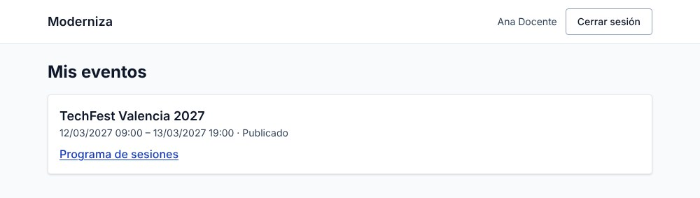
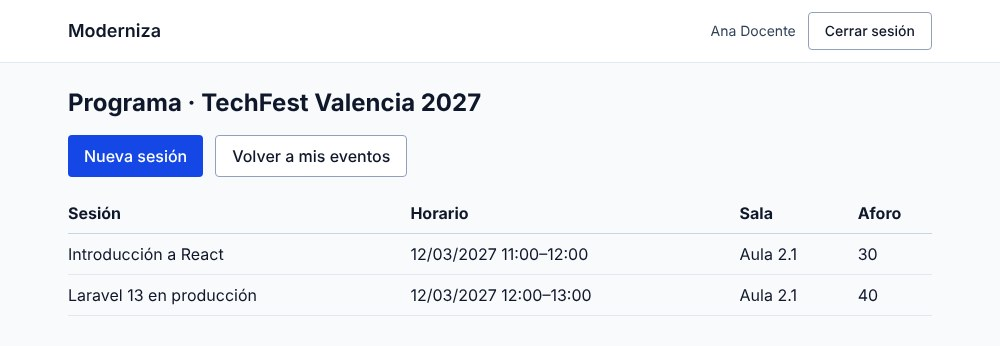
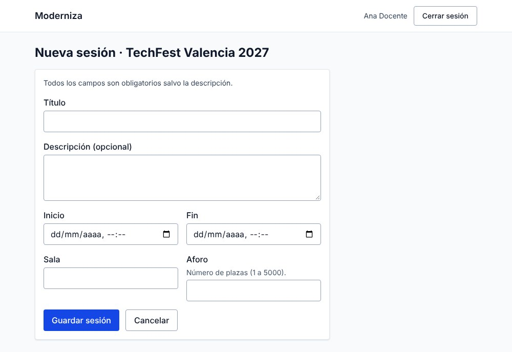
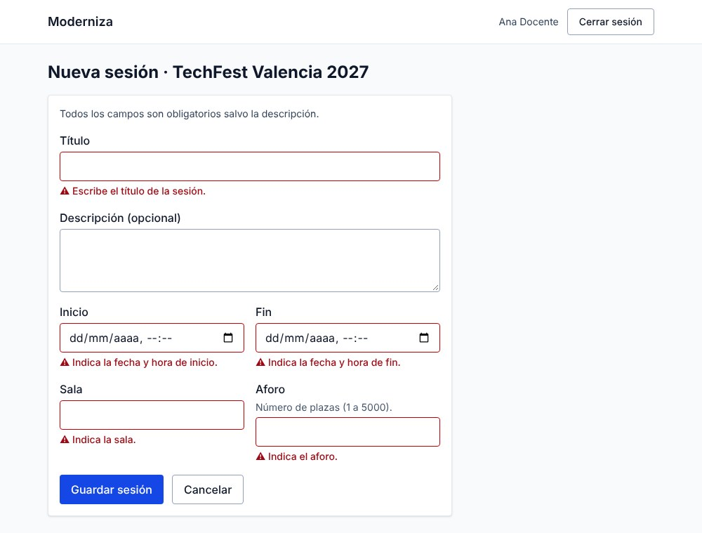
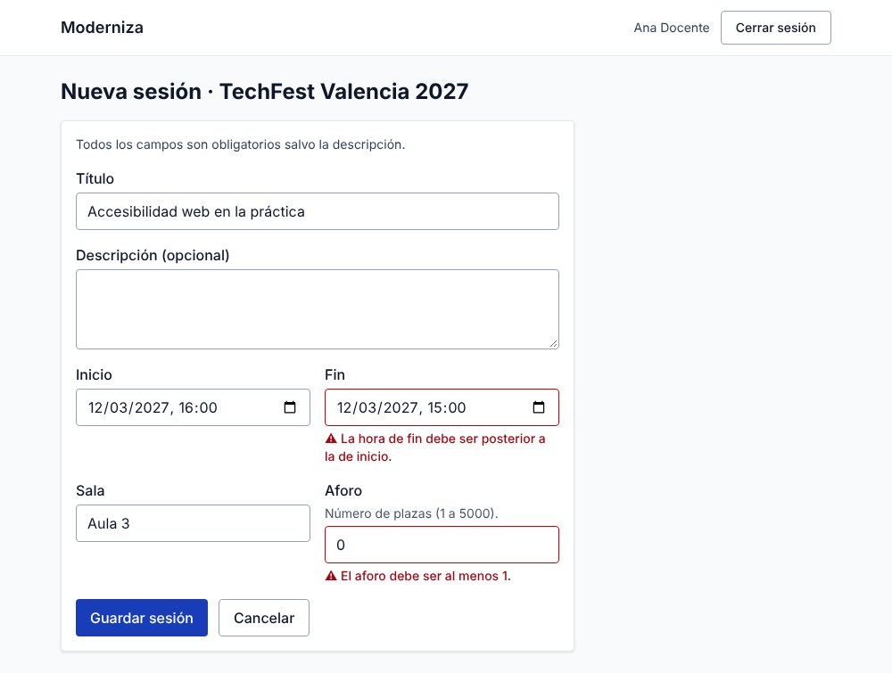
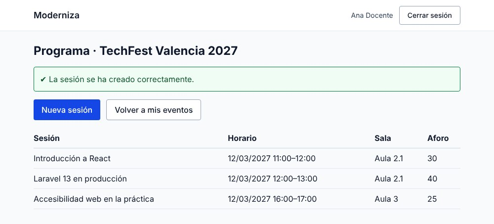

# Tarea 3 · Guía paso a paso

Esta guía os acompaña TODO a TODO. Para cada uno tenéis:

- **Para entenderlo**: qué es lo que vais a programar, para qué sirve y en qué paso del recorrido React → Inertia → Laravel → MySQL estáis (el esquema del enunciado).
- **Qué hacer**: lo que tenéis que conseguir en ese TODO, resumido (qué debe quedar hecho cuando terminéis). No explica cómo: para eso están el ejemplo y la pista.
- **Ejemplo en la plantilla**: código ya resuelto que se parece a lo que tenéis que escribir.
- **Pista**: el código con huecos (`___`). Rellenadlos; no lo copiéis sin entenderlo. Escribidlo en el **editor**: nunca peguéis código de una pista en la terminal (Bash interpreta el `>` y crea archivos con nombres raros).
- **Comprueba**: la orden que os dice si está bien **antes** de pasar al siguiente. Antes de lanzarla, mirad el panel *Problems* de VS Code: un error de sintaxis (círculo rojo) se ve al instante. En Windows, las comprobaciones con base de datos tardan de 1 a 3 minutos.
- **Error típico**: lo que suele fallar y cómo arreglarlo.

Mirad primero cómo debe quedar (siguiente apartado). Haced los TODO **en orden** (T3-1 → T3-7). Cada comprobación solo necesita los TODO anteriores.

Todas las órdenes se ejecutan desde la carpeta raíz del repositorio (donde está `docker-compose.yml`).

## Cómo se guarda el trabajo en Git

**Todos los TODO de esta tarea se hacen en la misma rama de trabajo, `t3-crear-sesion`**, con **un commit por cada TODO**. Al final se abre **una sola Pull Request**.

```
tarea-03-mejora-completa ──●───────────────────────────●── (tarea-03-entrega)
   (tarea-03-inicio)        \                         /
                             └─ t3-crear-sesion       /
                                 ●  T3-1 migración    /
                                 ●  T3-2 modelos     /
                                 ●  T3-3 validación /
                                 ●  …              /
                                 ●  T3-7 pruebas ── Pull Request (Closes #n)
```

- **Una sola rama** porque los siete TODO son partes de **una misma funcionalidad** («crear una sesión del programa», vuestra Issue del RF03) y cada uno depende del anterior: el modelo necesita la tabla, el controlador necesita el modelo… Por separado no funcionarían.
- **Un commit por TODO** (cuando su comprobación sale en verde), con un mensaje que diga qué habéis hecho, por ejemplo `T3-1: tabla event_sessions con claves externas e índice`. Así el historial cuenta el trabajo paso a paso, se ve en qué paso se rompió algo y el profesorado puede revisar cada parte.
- **Al terminar el T3-7:** Pull Request de `t3-crear-sesion` hacia `tarea-03-mejora-completa` (**no** hacia `develop`) con `Closes #n`; se revisa y se une (*Merge*), y sobre `tarea-03-mejora-completa` se crea y se sube la etiqueta `tarea-03-entrega`.
- Solo se crea **otra rama** si aparece **otra cosa distinta** (por ejemplo, un fallo que no tiene que ver con la sesión), con su propia Issue.

Así se trabaja también en las empresas: una rama corta por funcionalidad, commits pequeños y una Pull Request que alguien revisa antes de unirla. Cómo hacerlo desde VS Code o desde la terminal: manuales `Tarea3.7` y `Tarea3.8`.

---

## Así debe quedar

Estas capturas son de la solución, con datos ficticios. Muestran lo que tiene que hacer la aplicación cuando terminéis; los colores y estilos son los de la plantilla (cómo cambiarlos: anexo del final).

**1. Mis eventos** (ya viene hecha: es el ejemplo resuelto). Desde aquí se entra en el programa de cada evento.



**2. Programa de sesiones** (se abre cuando completáis T3-4). Lista las sesiones del evento y tiene el botón «Nueva sesión».



**3. Nueva sesión** (T3-6). Todos los campos tienen su etiqueta; la descripción es opcional.



**4. Formulario vacío** (T3-3 y T3-6). Al pulsar «Guardar sesión» aparece un mensaje junto a cada campo obligatorio.



**5. Datos incorrectos** (T3-3). Si la hora de fin es anterior a la de inicio o el aforo es 0, el mensaje explica el problema y **no se pierde lo escrito**.



**6. Datos correctos** (T3-5). Aparece «La sesión se ha creado correctamente» y la sesión nueva está en la lista.



---

## Antes de empezar

1. Arrancad todo: `docker compose up -d --build`.
2. Cread la base de datos de pruebas (solo la primera vez):
   - Linux, macOS, WSL o Git Bash:
     `docker compose exec -T db mysql -uroot -pyes < moderniza/docker/crear-bd-pruebas.sql`
   - Windows PowerShell:
     `Get-Content moderniza/docker/crear-bd-pruebas.sql | docker compose exec -T db mysql -uroot -pyes`
3. Abrid http://localhost:8000, iniciad sesión con vuestro organizador de Attendize y comprobad que aparece **Mis eventos**.
4. Buscad en el editor el texto `TODO T3-`: son los puntos que vais a completar.

**Comprueba:** `docker compose exec moderniza php artisan test --group=t3-1` se ejecuta y sale en **rojo** con mensajes «T3-1: falta…». Es lo normal: todavía no habéis empezado.

---

## T3-1 · La tabla `event_sessions` (migración)

**Archivo:** `moderniza/database/migrations/2026_11_01_000000_create_event_sessions_table.php`

> **Para entenderlo.** Una **migración** es un archivo PHP que describe cómo crear o cambiar una tabla. Es como un `CREATE TABLE`, pero guardado en Git: cualquiera que ejecute `php artisan migrate` obtiene la misma tabla.
>
> Vamos a crear `event_sessions`, la única tabla nueva de Moderniza. Cada sesión pertenece a un evento y a una cuenta, y eso se expresa con **claves externas**: MySQL no deja guardar una sesión de un evento que no existe y, si un evento se elimina de la tabla, MySQL elimina también sus sesiones (`cascadeOnDelete`).
>
> El **índice** es como el índice de un libro: hace que buscar «las sesiones del evento 1 de la cuenta 1» sea rápido.
>
> ¿Por qué `unsignedInteger` y no `foreignId`? Una clave externa solo funciona si las dos columnas son del mismo tipo. Attendize se hizo con `INT UNSIGNED`, así que nuestra columna también tiene que serlo.
>
> **En el recorrido:** paso 5, MySQL. Es donde acabará guardada la sesión que crea el formulario.

**Qué hacer:** definir las columnas de la tabla nueva, sus claves externas hacia `accounts` y `events`, y un índice.

**Ejemplo en la plantilla:** las líneas `$table->id();`, `$table->boolean('is_published')…` y `$table->timestamps();` del mismo archivo.

**Pista:**

```php
$table->unsignedInteger('account_id');
$table->unsignedInteger('___');
$table->foreign('account_id')->references('id')->on('accounts')->cascadeOnDelete();
$table->foreign('___')->references('id')->on('___')->cascadeOnDelete();

$table->string('title', ___);
$table->text('description')->________();   // opcional
$table->dateTime('starts_at');
$table->dateTime('___');
$table->string('room', ___);
$table->unsignedInteger('___');

// (después de timestamps)
$table->index(['account_id', '___', '___']);   // cuenta, evento y fecha de inicio
```

**Comprueba:**

```bash
docker compose exec moderniza php artisan migrate
docker compose exec moderniza php artisan test --group=t3-1
```

Debe salir `DONE` en la migración y `OK (3 tests…)` en las pruebas.

**Error típico:** `Cannot add foreign key constraint` (o `errno: 150`). Habéis usado `foreignId()`, que crea una columna `BIGINT`, pero en Attendize `accounts.id` y `events.id` son `INT UNSIGNED`. Usad `unsignedInteger()` + `foreign()`.

**Otro error típico:** `1072 Key column 'event_id ' doesn't exist`: hay un espacio dentro de las comillas del nombre de una columna (`'event_id '`).

**Si `migrate` falla a mitad** (no sale `DONE`), MySQL ya ha creado la tabla, pero Laravel no apunta la migración como hecha, así que `migrate:rollback` no la borra. Borrad solo esa tabla y volved a lanzar `migrate`:

```bash
docker compose exec moderniza php artisan tinker --execute="Schema::dropIfExists('event_sessions');"
```

Si la migración salió bien (`DONE`) y después queréis cambiarla: `migrate:rollback` y otra vez `migrate`. **Nunca** uséis `migrate:fresh`, `migrate:refresh`, `migrate:reset` ni `db:wipe`: la base es **la de Attendize** y borraríais todas sus tablas.

---

## T3-2 · Los modelos `EventSession` y `Event`

**Archivos:** `moderniza/app/Models/EventSession.php` y `moderniza/app/Models/Event.php`

> **Para entenderlo.** Un **modelo** (Eloquent) es la clase PHP que representa una tabla: cada objeto `EventSession` es una fila de `event_sessions`. Con él se lee y se guarda sin escribir SQL.
>
> **`$fillable`** es la lista de campos que se pueden rellenar «de golpe» con los datos que llegan del formulario (asignación masiva). Es una medida de seguridad: si `account_id` estuviera en la lista, alguien podría enviar desde el navegador el número de otra cuenta y la sesión quedaría a su nombre. Por eso `account_id` y `event_id` no van ahí: los pone el servidor en T3-5.
>
> **`casts()`** dice de qué tipo es cada dato. MySQL devuelve texto; con `datetime` las fechas se convierten en objetos de fecha (se pueden formatear y comparar) y con `integer` el aforo es un número.
>
> **La relación `sessions()`** expresa «un evento tiene muchas sesiones». Así se escribe `$event->sessions` en lugar de una consulta, y las sesiones salen ya ordenadas por hora de inicio.
>
> **En el recorrido:** también es el paso 5, porque el modelo es el puente entre el código PHP y la tabla de MySQL.

**Qué hacer:**

1. Indicar qué campos se pueden rellenar desde el formulario (`$fillable`).
2. Convertir las fechas a fecha y el aforo a número (`casts()`).
3. Escribir la relación «un evento tiene muchas sesiones», ordenadas por hora de inicio.

**Ejemplo en la plantilla:** el método `casts()` de `Event.php` (convierte `start_date`, `end_date` e `is_live`) y la relación `account()` del mismo archivo.

**Pista:**

```php
// EventSession.php
protected $fillable = ['title', 'description', '___', '___', '___', '___'];
// account_id y event_id NO van aquí: los pone el servidor (T3-5).

return [
    'starts_at' => '________',
    'ends_at'   => '________',
    'capacity'  => '________',
];

// Event.php
public function sessions(): HasMany
{
    return $this->hasMany(________::class)->orderBy('________');
}
```

**Comprueba:** `docker compose exec moderniza php artisan test --group=t3-2` → `OK (3 tests…)`.

**Error típico:** `Return value must be of type HasMany, none returned`: falta el `return` en `sessions()`. Si el mensaje dice «account_id NO debe estar en $fillable», quitadlo: si estuviera, alguien podría enviar desde el navegador el `account_id` de otra cuenta.

---

## T3-3 · Las reglas de validación

**Archivo:** `moderniza/app/Http/Requests/StoreEventSessionRequest.php`

> **Para entenderlo.** **Validar** es comprobar que los datos tienen sentido antes de guardarlos: que el título no esté vacío, que la hora de fin sea posterior a la de inicio o que el aforo sea un número entre 1 y 5000.
>
> Se valida **en el servidor** porque el navegador no es de fiar: cualquiera puede saltarse el formulario y enviar la petición directamente. La validación del navegador solo es una comodidad; la que protege los datos es esta.
>
> `StoreEventSessionRequest` es una clase de Laravel que se ejecuta **antes** del controlador. Si algún dato no cumple las reglas, Laravel no llega a guardar nada: devuelve los errores al formulario junto con lo que el usuario había escrito. Cada regla se lee de izquierda a derecha: `['required', 'string', 'max:120']` significa «obligatorio, de texto y como mucho 120 caracteres».
>
> **En el recorrido:** paso 3, Validación.

**Qué hacer:** escribir en `rules()` las reglas de cada campo. Los mensajes en español ya están hechos en `messages()`: fijaos en ellos, os dicen qué reglas hacen falta.

**Ejemplo en la plantilla:** el método `messages()` del mismo archivo (cada clave `campo.regla` corresponde a una regla).

**Pista:**

```php
return [
    'title'       => ['required', 'string', 'max:___'],
    'description' => ['________', 'string', 'max:5000'],
    'starts_at'   => ['required', '____'],
    'ends_at'     => ['required', 'date', '________:starts_at'],   // posterior al inicio
    'room'        => ['required', 'string', 'max:___'],
    'capacity'    => ['required', '_______', 'min:_', 'max:____'],
];
```

**Comprueba:** `docker compose exec moderniza php artisan test --group=t3-3` → `OK (2 tests…)`. Si falla, el mensaje dice qué dato se ha aceptado cuando debía rechazarse (por ejemplo, «capacity con decimales»).

**Error típico:** olvidar `nullable` en `description` (la descripción es opcional) o escribir `after:start_at` en lugar de `after:starts_at`.

---

## T3-4 · Solo eventos de mi cuenta (autorización)

**Archivo:** `moderniza/app/Http/Controllers/EventSessionController.php`, método `findOwnEvent()`

> **Para entenderlo.** **Autenticación** es saber *quién eres* (ya lo hace el inicio de sesión). **Autorización** es saber *qué puedes hacer*: aquí, que solo puedes ver y cambiar el programa de los eventos de **tu** cuenta.
>
> `findOwnEvent()` busca el evento por su número, pero **dentro de la cuenta del usuario conectado** (`ofAccount`). Si el evento es de otra cuenta, para esa consulta «no existe», y `firstOrFail()` responde con un **404**.
>
> ¿Por qué 404 y no 403 («prohibido»)? Con un 403 confirmaríamos que ese evento existe en otra cuenta; con un 404 no damos ninguna pista. Ocultar un botón en la pantalla no basta: alguien puede escribir la dirección a mano, y por eso la comprobación se hace en el servidor.
>
> **En el recorrido:** paso 4, Permiso. Lo usan el listado, el formulario y el guardado.

**Qué hacer:** buscar el evento por su id **dentro de la cuenta del usuario que ha iniciado sesión**. Si el evento es de otra cuenta, la respuesta debe ser 404 (no se revela que existe).

**Ejemplo en la plantilla:** `EventController::index()`, que lista solo los eventos de la cuenta con `ofAccount(...)`.

**Pista:**

```php
return Event::query()
    ->ofAccount($request->user()->________)
    ->whereKey($________)
    ->____________();   // si no lo encuentra, responde 404
```

**Comprueba:**

```bash
docker compose exec moderniza php artisan test --group=t3-4
```

`OK (2 tests…)`. En el navegador, desde **Mis eventos**, el enlace **Programa de sesiones** ya abre la página (antes salía `501 TODO T3-4`).

**Error típico:** usar `Event::find($eventId)` o `findOrFail($eventId)` sin filtrar por cuenta: funciona con vuestros eventos, pero también abre los de otras cuentas. La prueba «el evento de otra cuenta responde 404» lo detecta.

---

## T3-5 · Guardar la sesión y su ruta

**Archivos:** `EventSessionController::store()` y `moderniza/routes/web.php`

> **Para entenderlo.** Una **ruta** une una dirección y un método HTTP con el código que la atiende: `POST /events/1/sessions` significa «crear una sesión en el evento 1». Se usa POST porque **crea** algo; para consultar se usa GET.
>
> El **controlador** es el código que hace el trabajo. `store()` sigue siempre el mismo orden:
> 1. Comprueba que el evento es tuyo (T3-4).
> 2. Crea la sesión **solo con los datos validados** (T3-3).
> 3. Pone `account_id` y `event_id` desde el servidor (por eso no estaban en `$fillable`).
> 4. Guarda en MySQL (`save()` ejecuta el `INSERT`).
> 5. Redirige al listado con un mensaje.
>
> Redirigir después de guardar evita que, al recargar la página, el navegador vuelva a enviar el formulario y se cree la sesión dos veces. El mensaje viaja en la sesión (`with('success', ...)`) y la pantalla lo muestra una sola vez.
>
> **En el recorrido:** pasos 2 (la ruta recibe la petición) y 5 (guardar), y prepara el 6 (la respuesta).

**Qué hacer:**

1. Añadir la ruta `POST /events/{eventId}/sessions`.
2. En `store()`: localizar el evento con `findOwnEvent()`, crear la sesión **solo con los datos validados**, poner `account_id` y `event_id` en el servidor, guardar y volver al listado con un mensaje.

**Ejemplo en la plantilla:** las dos rutas `GET` de sesiones que hay justo encima en `web.php`, y el método `create()` del controlador (usa `findOwnEvent()`).

**Pista:**

```php
// routes/web.php
Route::____('/events/{eventId}/sessions', [EventSessionController::class, '_____'])
    ->whereNumber('eventId')->name('events.sessions._____');

// EventSessionController::store()
$event = $this->findOwnEvent($request, $eventId);

$session = new EventSession($request->_________());
$session->account_id = $request->user()->account_id;
$session->event_id = $event->___;
$session->save();

return redirect()
    ->route('events.sessions.index', $event->id)
    ->with('success', 'La sesión se ha creado correctamente.');
```

**Comprueba:** `docker compose exec moderniza php artisan test --group=t3-5` → `OK (2 tests…)`. También podéis ver la ruta con `docker compose exec moderniza php artisan route:list --except-vendor`.

**Error típico:** `405 Method Not Allowed`: falta la ruta `POST` o tiene otro nombre. Si usáis `$request->all()` en lugar de `$request->validated()`, el navegador podría colar campos que no habéis validado.

---

## T3-6 · El formulario en React

**Archivo:** `moderniza/resources/js/pages/Sessions/Create.tsx`

> **Para entenderlo.** Esta pantalla es un **componente de React**: una función que devuelve lo que se ve (JSX). React la vuelve a dibujar cada vez que cambian sus datos.
>
> `useForm` (de Inertia) guarda el estado del formulario:
> - `data`: lo que el usuario ha escrito.
> - `setData`: actualiza `data` al escribir.
> - `post`: envía los datos a Laravel.
> - `errors`: los mensajes que devuelve la validación (T3-3).
> - `processing`: vale `true` mientras se espera la respuesta.
>
> **Inertia** hace de puente: envía la petición sin recargar la página y, si Laravel devuelve errores, los coloca en `errors` sin borrar lo escrito. Desactivar el botón mientras `processing` es `true` evita que alguien pulse dos veces y cree la sesión repetida. El componente `Field` ya se ocupa de la etiqueta y de unir el mensaje de error con su campo (accesibilidad).
>
> **En el recorrido:** paso 1, React. Es el inicio de todo y también el final, porque aquí se ven los errores o la confirmación.

**Qué hacer:** añadir los campos que faltan, enviar el formulario con Inertia y desactivar el botón mientras se guarda.

**Ejemplo en la plantilla:** el campo **Título** del mismo archivo (marcado como EJEMPLO RESUELTO). El componente `Field` ya asocia la etiqueta y el mensaje de error.

**Pista:**

```tsx
// Envío (dentro de submit)
post(`/events/${event.id}/sessions`, { preserveScroll: ____ });

// Un campo: copiad el de Título y cambiad lo necesario
<Field label="Inicio" id="starts_at" error={errors.________}>
    <input
        type="datetime-local"
        value={data.starts_at}
        onChange={(e) => setData('________', e.target.value)}
    />
</Field>
// Repetid con: Fin (ends_at, datetime-local), Sala (room, text, maxLength={80})
// y Aforo (capacity, type="number", min={1}, max={5000})

// Botón
<button type="submit" className="btn-primary" disabled={__________}>
    {processing ? 'Guardando…' : 'Guardar sesión'}
</button>
```

**Comprueba:**

```bash
docker compose exec moderniza-vite npm run types
```

Sin errores. Después, en el navegador: **Mis eventos → Programa de sesiones → Nueva sesión**:

- enviad el formulario vacío: aparece un error junto a cada campo obligatorio;
- poned fin anterior al inicio y aforo 0: errores claros y **no se pierde lo escrito**;
- datos correctos: aparece «La sesión se ha creado correctamente» y la sesión sale en la tabla.

**Error típico:** el campo se ve pero no se guarda: el `id` del `Field` o el nombre en `setData('...')` no coinciden con el de Laravel (`starts_at`, `ends_at`, `room`, `capacity`). Si `npm run types` dice que un nombre no existe en `SessionForm`, revisad cómo lo habéis escrito. Y si al pulsar «Guardar sesión» no pasa nada, es que `submit()` todavía no envía el formulario: no es un fallo del servidor.

---

## T3-7 · Vuestras pruebas

**Archivo:** `moderniza/tests/Feature/CreateEventSessionTest.php`

> **Para entenderlo.** Una **prueba automática** es código que usa la aplicación como lo haría una persona y comprueba el resultado. Por ejemplo: «inicio sesión como Ana, envío un título vacío y compruebo que hay un error y que no se ha guardado nada».
>
> Las pruebas se ejecutan contra la base `moderniza_test`: se crean sus tablas desde cero, cada prueba fabrica sus propios datos inventados (*factories*) y al terminar se deshacen sus cambios. Así nunca tocan los datos de Attendize.
>
> Sirven para dos cosas. **Demuestran** que se cumplen los criterios de aceptación, con datos correctos, incorrectos y de otra cuenta. Y **protegen** el trabajo: si mañana alguien quita una regla de validación o el filtro por cuenta, la prueba se pone en rojo y avisa.
>
> `markTestIncomplete` es solo una marca de «pendiente»: mientras esté, la prueba no se ejecuta.
>
> **En el recorrido:** comprueban el camino completo, del paso 1 al 6.

**Qué hacer:** completar las dos pruebas marcadas con `TODO T3-7` (quitad la línea `markTestIncomplete`).

**Ejemplo en la plantilla:** la primera prueba del mismo archivo, `test_el_organizador_crea_una_sesion_en_su_evento` (EJEMPLO RESUELTO), y `ExampleEventsTest.php`.

**Pista:**

```php
// Datos inválidos
$user = User::factory()->create();
$event = Event::factory()->create(['account_id' => $user->account_id]);

$response = $this->actingAs($user)->post("/events/{$event->id}/sessions", array_merge($this->validData(), [
    'title' => '',
    'ends_at' => '2027-03-12 09:00:00',   // antes del inicio
    'capacity' => ___,
]));

$response->assertSessionHasErrors(['title', '_______', '________']);
$this->assertDatabaseCount('event_sessions', _);

// Otra cuenta
$user = User::factory()->create();
$otherEvent = Event::factory()->create();   // es de OTRA cuenta

$this->actingAs($user)
    ->post("/events/{$otherEvent->id}/sessions", $this->validData())
    ->________________();   // 404

$this->assertDatabaseCount('event_sessions', _);
```

**Comprueba:** `docker compose exec moderniza php artisan test` → todo en verde y **ninguna** prueba «incompleta».

**Error típico:** dejar la línea `$this->markTestIncomplete(...)`: la prueba nunca se ejecuta. Para comprobar que vuestra prueba sirve, quitad un momento la regla `after:starts_at` de T3-3: la prueba de datos inválidos debe ponerse en rojo. Después volved a ponerla.

---

## Al terminar

- [ ] `php artisan test`: todo en verde, ninguna incompleta.
- [ ] `npm run types`: sin errores.
- [ ] En el navegador: caso correcto, datos inválidos y URL de un evento de otra cuenta (404).
- [ ] `docker compose stop` y `docker compose start`: la sesión sigue ahí.
- [ ] Teclado (`Tab`) y vista móvil revisados.
- [ ] Pull Request con `Closes #n` integrada y etiqueta `tarea-03-entrega` subida.

## Anexo · Dónde está el aspecto de la aplicación (y cómo cambiarlo)

El aspecto de Moderniza lo dan **dos cosas que trabajan juntas**:

- **React** (`moderniza/resources/js/`) decide **qué hay** en cada pantalla: páginas (`pages/`), componentes (`components/`), formularios y botones. Los colores y tamaños se ponen con **clases de Tailwind CSS** en el atributo `className`, por ejemplo `className="bg-white p-4"`.
- **Tailwind CSS** (`moderniza/resources/css/app.css`) es la **guía visual** de toda la aplicación. Ahí están el fondo de la página (`body`), las clases propias que usan todas las pantallas (`.btn-primary`, `.btn-secondary`, `.link`, `.card`, `.input`) y el contorno de foco para el teclado (`:focus-visible`).

`moderniza/resources/js/components/Layout.tsx` es el marco común de todas las páginas (cabecera, título y menú).

**Ejemplos** (cada clase de Tailwind hace una sola cosa; al guardar, Vite actualiza el navegador solo):

| Quiero… | Dónde | Cambio |
|---|---|---|
| Fondo lila en toda la aplicación | `app.css`, regla `body` | `bg-slate-50` → `bg-violet-100` |
| Cabecera de otro color | `Layout.tsx`, etiqueta `<header>` | `bg-white` → `bg-violet-200` |
| Botón principal de otro color | `app.css`, clase `.btn-primary` | `bg-blue-700 … hover:bg-blue-800` → `bg-violet-700 … hover:bg-violet-800` |
| Botones con los bordes muy redondeados | `app.css`, clases `.btn-primary` y `.btn-secondary` | `rounded` → `rounded-full` (o `rounded-lg`, menos redondeado) |
**Reglas para cambiarlo bien:**

- Cambiad la **guía** (`app.css` y `Layout.tsx`), no un color suelto en cada página: así toda la aplicación queda coherente.
- Mantened el **contraste** (texto oscuro sobre fondo claro y botones con texto blanco sobre un color oscuro, por ejemplo `-700` u `-800`) y el **contorno de foco** visible: es accesibilidad y se evalúa.
- Un cambio de aspecto **no forma parte de los TODO**: hacedlo en **otra rama** (por ejemplo, `estilo-lila`), con su propio commit, sin mezclarlo con `t3-crear-sesion`. Vuestras pantallas ya no se verán como las capturas: es normal.
